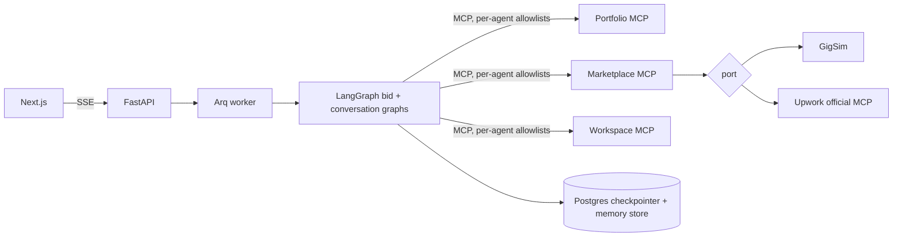

# GigBid: a multi-agent freelancer copilot

**A team of LangGraph agents finds freelance jobs, flags scams and injected instructions, and drafts
proposals in which every claim links to real portfolio evidence. Nothing reaches a client until a human
approves it.**

* Live app: **LIVE_URL** (reviewer login in the Classroom private comment)
* Demo video (3 min): **VIDEO_URL**
* Public traces: **TRACE_LINKS**
* Portfolio MCP server: [`mcp_servers/portfolio`](mcp_servers/portfolio/README.md) · Write-up: **WRITEUP_URL**


## What it does

1. **Scout** pulls new jobs from saved searches on a schedule and drops reposts.
2. **Job Analyst**, **Risk Assessor** and **Fit Matcher** analyse each job **in parallel**: a typed job
   spec; scam, off-platform and injection flags plus client quality; and a requirement-to-evidence matrix.
3. A rule-based decision says **bid, watch or skip** with reasons. The **Pricing Strategist** prices from
   real market quartiles and refuses to spend Connects with negative expected value.
4. The **Writer** drafts with evidence ids. The **claim verifier** removes unsupported sentences, the
   **Critic** sends weak drafts back (at most twice), and the **Compliance Guard** enforces the policy pack.
5. The graph **pauses** (`interrupt()`) with a dry-run preview of exactly what will be sent and what it
   costs. You approve, edit (diffed, re-checked, may teach GigBid your style) or reject with a reason.
6. Client replies start the **conversation graph**: intent, interview slots from your calendar, a drafted
   reply, the same approval gate.

## Architecture



Details: [docs/ARCHITECTURE.md](docs/ARCHITECTURE.md) · tools: [docs/TOOLS.md](docs/TOOLS.md) ·
data: [docs/DATA_CARD.md](docs/DATA_CARD.md) · operations: [docs/RUNBOOK.md](docs/RUNBOOK.md) ·
decisions: [docs/adr](docs/adr) · extension: [docs/EXTENSION.md](docs/EXTENSION.md) ·
change request: [docs/CHANGE_REQUEST.md](docs/CHANGE_REQUEST.md) · AI usage: [docs/AI_USAGE.md](docs/AI_USAGE.md)

## Results

All numbers below are generated by `tools/results_tables.py` from `evals/results/*.json`
(`make eval` re-runs them; CI fails if a number here is not in a results file).

<!-- results:start -->
### Retrieval and proposals (B5)

| Variant | Evidence Recall@5 | MRR | nDCG@10 | p95 retrieval latency (s) | n jobs |
|---|---|---|---|---|---|
| v0_naive | 0.267 | 0.433 | 0.275 | 0.0005 | 544 |
| v1_decompose | 0.225 | 0.400 | 0.247 | 0.0019 | 544 |
| v2_hybrid | 0.358 | 0.526 | 0.359 | 0.0182 | 544 |
| v3_rerank | 0.263 | 0.366 | 0.257 | 3.4206 | 544 |
| v4_outcome | 0.142 | 0.317 | 0.160 | 0.0006 | 544 |
| v5_multivector | 0.233 | 0.411 | 0.248 | 0.0018 | 544 |
| v6_contextual | 0.391 | 0.532 | 0.391 | 0.0006 | 544 |
| best | 0.502 | 0.627 | 0.507 | 0.0048 | 544 |

### Ablation

| Config | Recall@5 | MRR | nDCG@10 |
|---|---|---|---|
| best | 0.502 | 0.627 | 0.507 |
| best-contextual | 0.360 | 0.532 | 0.361 |
| best-hybrid | 0.391 | 0.532 | 0.391 |

### Breakdown

Recall@5 by persona and job type:

| Variant | ai_ml_engineer | fullstack_web | data_analyst | real Kaggle posts | synthetic posts | >=4 requirements |
|---|---|---|---|---|---|---|
| v0_naive | 0.255 | 0.272 | 0.275 | 0.251 | 0.303 | 0.339 |
| v1_decompose | 0.232 | 0.251 | 0.194 | 0.242 | 0.188 | 0.163 |
| v2_hybrid | 0.358 | 0.365 | 0.350 | 0.350 | 0.374 | 0.406 |
| v3_rerank | 0.257 | 0.246 | 0.284 | 0.242 | 0.309 | 0.313 |
| v4_outcome | 0.143 | 0.142 | 0.140 | 0.142 | 0.143 | 0.193 |
| v5_multivector | 0.239 | 0.224 | 0.236 | 0.224 | 0.255 | 0.289 |
| v6_contextual | 0.385 | 0.403 | 0.387 | 0.365 | 0.451 | 0.443 |
| best | 0.524 | 0.496 | 0.485 | 0.459 | 0.597 | 0.551 |

### Decisions and budgets

_Decision evaluation not run._

### Multi-agent comparison (R&D C)

_Multi-agent comparison not run._

### Tool granularity (R&D A)

_Tool-design study not run._

### Prompt injection (E4)

_Injection evaluation not run._

<!-- results:end -->

## Run it

```bash
cp .env.example .env            # add GROQ_API_KEY (free tier is enough)
docker compose -f infra/docker-compose.yml up --build    # web http://localhost:3000, api :8000
make test    # unit + MCP contract + integration
make eval    # retrieval, decision, proposal and outcome evaluations
```

Open models only (Groq-hosted gpt-oss-20b/120b, Qwen 3.8 27B; BGE-small embeddings and a MiniLM
cross-encoder on CPU); `GIGBID_PROFILE=local` runs everything on Ollama.

## Pinned versions

Python 3.12: langgraph 1.2.21, langchain-core 1.8.0, langchain-mcp-adapters 0.3.2, mcp 1.30.0,
fastapi 0.162.6, sentence-transformers 5.4.1 (full list in `pyproject.toml`).
Web: next 16.4.3, react 19.3.1, openapi-typescript 7.13.0, @playwright/test 1.64.1 (`apps/web/package.json`).

## Résumé bullet

RESUME_BULLET

## Data and integrity

Personas, clients and portfolios are synthetic; ~70% of job posts are real public Upwork posts from
Kaggle datasets (attribution in the data card). The hidden test set never enters the repo. Live mode uses
only the official Upwork MCP server; GigBid never scrapes, never automates a browser and never sends
anything without your approval.
