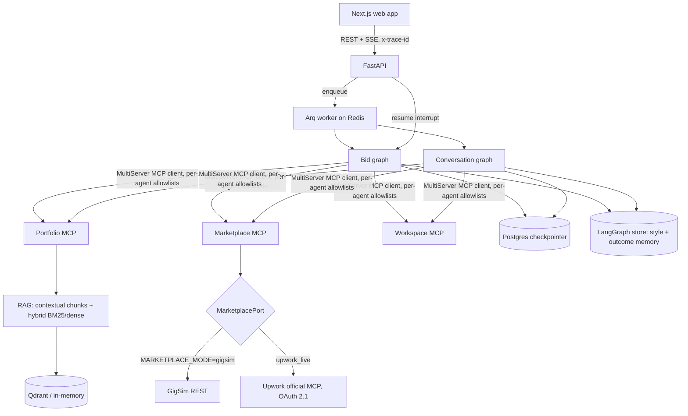
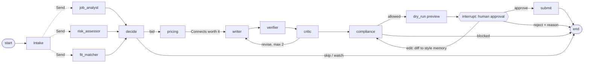

# Architecture

## Bid graph (one thread per job)

Rendered from code: `python -m agent.graphs.bid_graph --mermaid` (and `agent.graphs.conversation_graph`).

## Why each agent exists

| Agent | Why it is separate | Model |
|---|---|---|
| Scout | Scheduled, polite polling and de-duplication must run without any LLM and outside requests. | none |
| Job Analyst | Turns an untrusted post into a typed `JobSpec`; isolating it means injected text can only influence a structured object, never an action. | gpt-oss-20b |
| Risk Assessor | Rules (scams, off-platform, injections) can only add flags, so an LLM fooled by an injection cannot clear a rule hit. Needs client history (Marketplace read). | gpt-oss-20b + rules |
| Fit Matcher | Requirement-to-evidence matrix; deterministic exact tool matching + cross-encoder for free text, so "fit" is explainable per requirement. Runs in parallel with the two above. | none (retrieval) |
| Decide | Explainable rules over the three typed reports; thresholds in `agent/config.yaml`. | none |
| Pricing Strategist | Real market quartiles + client quality + floor; refuses to spend Connects with negative expected value. | none |
| Proposal Writer | Only agent that writes prose; may only cite evidence ids it was given. | gpt-oss-120b |
| Claim verifier | Removes unsupported sentences before the Critic sees the draft (R5). Numbers and tool names are checked lexically. | none (cross-encoder) |
| Critic | Grounding/personalisation/length gate with at most 2 rewrites (C4). | gpt-oss-120b |
| Compliance Guard | Policy pack as data (regex rules + limits); redacts contacts/links/guarantees, blocks unsupported claims. | none |
| Client Liaison | Second graph: intent, interview slots (Workspace MCP), reply, approval, send. | gpt-oss-120b |

## State, trace, memory (C2)

* **State** (`agent/state.py`): typed fields for the job, the three analyses, decision, price, draft,
  critiques, compliance, approval, submission. Parallel branches write disjoint keys or reducer keys
  (`evidence` dedupe, `usage` sum, `errors`/`trace`/`halts` append).
* **Execution trace**: `trace` (every node: name, args, result summary, tokens, latency) in the
  checkpoint + `run_events` table (SSE) + the MCP audit log, all keyed by one trace id.
* **Long-term memory** (`agent/memory/`): only `promotion_rules.py` writes `("style", user)` and
  `("outcome", user)`; raw observations live in separate namespaces never shown to an LLM.

## Durability and exactly-once (C6)

Checkpointer = Postgres (`PostgresSaver`) in deployment, a file-backed saver locally. Kill the API while
a proposal waits at `approval`: the interrupt is in the checkpoint, the Approvals page re-reads it,
approving resumes the thread. Submission uses idempotency keys `"{thread_id}:draft"` and
`"{thread_id}:submit"`, stored by GigSim/the marketplace server, so a crash between submit and
checkpoint write replays the same response instead of submitting twice
(`tests/integration/test_mcp_servers.py::test_marketplace_read_and_idempotent_write`).
Replay from any node: `graph.get_state_history(config)` then `graph.invoke(None, checkpoint_config)`.
The same mechanism drives degraded-mode recovery: a node that meets a dead marketplace returns
`needs_attention` with a "marketplace unavailable" error; once the marketplace answers, `worker/runner.py::recover`
resumes the thread from the newest checkpoint without that error (for an approved proposal, just before
`submit`), so the outage costs a delay, never a lost approval or a double submit
(`tests/unit/test_degraded_recovery.py`).

## Failure handling (C7)

Per-node retries with backoff and timeouts, fallback model for structured output, `dead_letter` after the
last retry, `needs_attention` for budget overruns and marketplace outages, GigSim 429 (Retry-After
honoured) and 5xx (exponential backoff) handled in the adapter.
